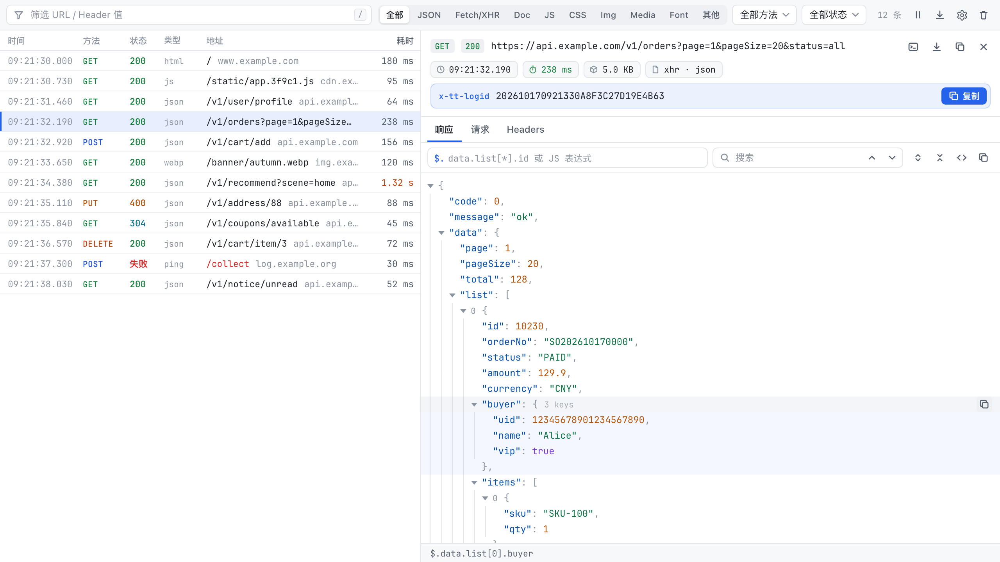
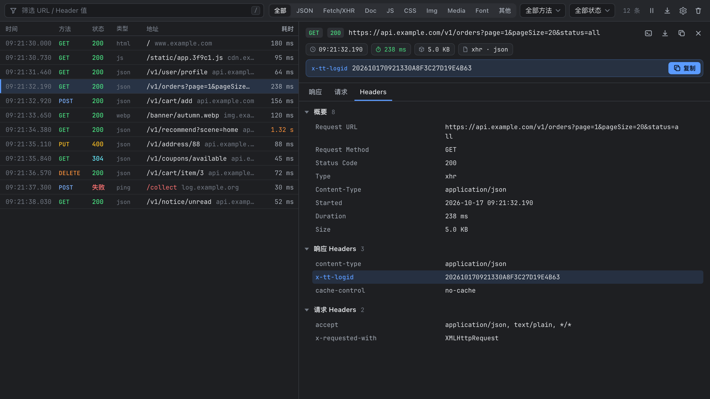
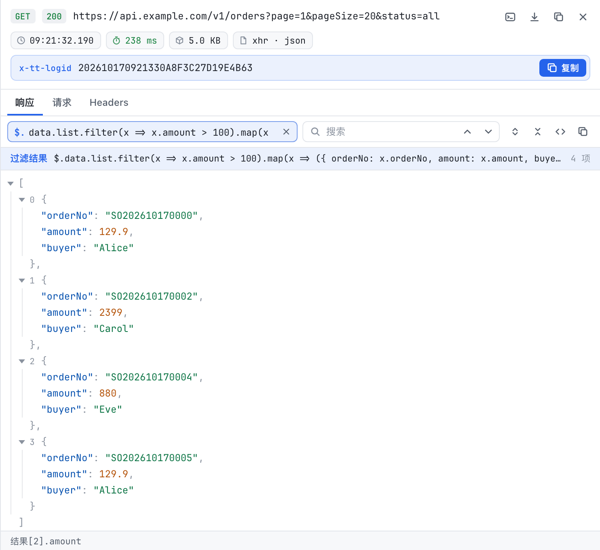

# API Lens

Edge / Chrome DevTools 扩展：在 DevTools 中新增「API Lens」标签页，查看当前标签页的网络请求，重点优化 JSON 接口的查看与排查——JSON 格式化 / 折叠 / 搜索、`$.path` 与 JS 表达式过滤、复制 cURL、支持配置自动提取 Header（独立展示并提供一键复制）、导出 HAR。



<details>
<summary>暗色主题</summary>



</details>

## 安装

1. 在 [Releases](https://github.com/wmgx/api_lens/releases) 下载最新的 `api-lens-x.y.z.zip` 并解压（或直接克隆本仓库）
2. 打开 `edge://extensions`（Chrome 为 `chrome://extensions`），开启「开发人员模式」
3. 点击「加载解压缩的扩展」，选择解压后的目录（包含 `manifest.json`）；更新后在该页点「重新加载」，并重新打开 DevTools
4. 在任意页面按 `F12` 打开 DevTools，切换到 **API Lens** 标签页（可能折叠在 `»` 里）

## 行为说明

- 打开 DevTools 后开始记录全部请求，和原生 Network 面板一致；刷新页面后继续追加，旧记录保留；关闭 DevTools 后清空
- 不限条数，按请求开始时间升序展示；每个标签页的 DevTools 相互独立
- 「JSON」按响应 `Content-Type` 含 json 识别，Fetch/XHR 还会按响应内容识别（如 `text/plain` 返回 JSON）
- 不记录 WebSocket
- Fetch/XHR 的文本响应在请求完成时读取；其他资源（文档、脚本、图片、下载等）在查看时按需读取，页面跳转后可能已被 DevTools 释放

## 功能

| 功能 | 说明 |
|------|------|
| 列表 | 时间、方法、状态（失败请求标红）、类型、地址、耗时；悬停显示完整 URL、类型大小与提取的 Header |
| 类型筛选 | 全部 / JSON / Fetch/XHR / Doc / JS / CSS / Img / Media / Font / 其他，⌘/Ctrl+点击多选，默认 JSON；放不下时可横向滚动 |
| 筛选 | 关键词匹配 URL 和提取的 Header 值（空格分隔多个，`-` 前缀排除）、方法、状态码（下拉框，支持键盘）；历史最多 10 条，回车或选中请求时记录，可下拉选择 / 删除；所有输入框有内容时可点 × 清空 |
| 暂停 / 导出 | 暂停期间的请求不记录；导出当前列表或选中请求为 HAR / JSON |
| 右键菜单 | 复制 cURL / URL / 提取的 Header / 响应体 / 请求体，下载响应体，导出此请求，只看 / 隐藏此 Host |
| 设置（齿轮） | 自动提取 Header（每行一个，默认 `x-tt-logid`）；Host 过滤（显示全部 / 仅显示匹配 / 隐藏匹配，支持 `*`），只影响展示 |
| 详情 | 顶部显示方法、状态、完整 URL，以及时间 / 耗时 / 大小 / 类型标签（悬停看完整日期、传输大小、MIME）；提取的 Header 一键复制；可复制 cURL、URL，下载响应体。Headers 页分概要 / 响应头 / 请求头，请求页显示 Query 参数和请求体；每行悬停可复制值，标题可复制整组 |
| 响应 | JSON 用查看器；图片直接预览（显示尺寸）；其他文本按原文显示；二进制显示文件信息并可下载（文件名取自 Content-Disposition） |
| JSON 查看 | 格式化、高亮（树形和文本模式都有）、缩进引导线、数组下标、折叠（折叠后显示 `{…}` 和数量，Alt+点击递归）、悬停复制；长字符串在值内折行，换行 / 引号按转义显示（复制仍为原值）；超大整数不丢精度 |
| JSON 搜索 | 搜索 key / value，Enter / Shift+Enter 跳转，自动展开并定位 |
| 路径栏 | 底部显示悬停节点的 `$.path`，点击复制；右键节点可复制值 / 路径 / key、按此路径过滤 |
| 表达式过滤 | 输入框固定以 `$.` 开头，切换请求时保留，历史可下拉选择 / 删除（见下） |

所有图标按钮悬停都有说明。

### 表达式过滤

输入框已带 `$.` 前缀，直接从字段名开始写：

| 写法 | 示例 |
|------|------|
| 路径 | `data.user.name`、`data.list[0]`、`data.list[-1]`、`data['x-key']`；根是数组时写 `[0]` |
| JSONPath | `data.list[*].id`、`.id`（即 `$..id` 递归）、`data.list[0:5]`、`data.*` |
| JS 表达式 | `data.list.filter(x => x.status !== 0).map(x => ({ id: x.id, name: x.name }))`、`data.list.length` |



JS 表达式在扩展的沙箱页中执行，不能访问页面和扩展权限。超出安全整数范围的数字以原文保留，参与数值比较时会失真。

## 快捷键

| 按键 | 作用 |
|------|------|
| `/` 或 `⌘/Ctrl+K` | 聚焦筛选框 |
| `↑` `↓` / `k` `j` | 切换选中请求（输入框内为选择历史） |
| `⌘/Ctrl+F` | 在当前 JSON 中搜索 |
| `Esc` | 关闭详情 / 清空搜索 / 清除表达式 |

## 结构

```
manifest.json
src/devtools.html, devtools.js   # 收集请求（chrome.devtools.network），按需读取响应体
src/panel/                       # 面板 UI：列表、详情、JSON 查看器、设置、历史、右键菜单、导出
src/sandbox/                     # 表达式求值沙箱（路径 / JSONPath / JS）
icons/
scripts/package.sh               # 校验并打包
tests/panel_test.py              # 面板回归测试（Playwright）
.github/workflows/build.yml      # CI：自动打包，推送 v* tag 自动发布 Release
```

## 开发与发布

```bash
./scripts/package.sh          # 语法检查并打包到 dist/api-lens-<manifest 版本>.zip
./scripts/package.sh 1.3.0    # 指定版本号打包（写入产物中的 manifest）
```

- 推送到 `main` 或提交 PR：GitHub Actions 自动校验并打包，zip 可在该次运行的 Artifacts 中下载
- 推送 `v*` tag（如 `git tag v1.3.0 && git push origin v1.3.0`）：自动打包并发布 Release，版本号取自 tag

## 实现要点

改代码前建议先读这一节，下面几处设计不看说明不容易想到。

- **请求收集与面板通信**：请求由 `src/devtools.js`（DevTools 页）通过 `chrome.devtools.network.onRequestFinished` 收集，存在内存 store 中。所以只要 DevTools 开着，即使没切到 API Lens 面板也会记录。面板首次显示时，`panel.onShown` 把 store 挂到面板的 `window.__jniStore` 并调用 `window.__jniAttach`，两边共用同一份数据，没有消息序列化。
- **响应体读取**：Fetch/XHR 的文本响应（≤ 5MB）在请求完成时立即读取，因为页面跳转后 DevTools 可能释放内容。其他资源在查看时由 `store.loadContent` 按需读取，并用 WeakMap 缓存。
- **表达式在沙箱中执行**：MV3 扩展页的 CSP 禁止 `eval` / `new Function`，所以 JS 表达式和 JSONPath 在 `src/sandbox/`（manifest 中声明的 sandbox 页）里执行。面板通过隐藏 iframe 加 `postMessage` 调用（`sandboxClient.js`），超时 5 秒。沙箱无法访问页面和扩展 API。
- **大整数不丢精度**：`JSON.parse` 的 reviver 读取第三个参数 `context.source`，超出安全整数范围时用 `JSON.rawJSON` 保留原文（面板和沙箱各有一份）。依赖 Chrome 114+，这就是 manifest 中 `minimum_chrome_version` 的来源。
- **请求列表**：虚拟滚动，行高固定 26px，只渲染可视区。行元素按记录 id 复用，新请求到来时只增删变化的行。不要改回 `innerHTML` 整体重建，否则悬停中的行会被替换，导致闪烁、悬停提示不出现。
- **JSON 树**：节点展开时才渲染子节点，子节点超过 500 个时分批加载；搜索命中时自动展开祖先节点。
- **设置与历史**：存在 `chrome.storage.local`，不可用时（如普通网页里调试面板）退回 `localStorage`。
- **测试**：`tests/panel_test.py` 在本地起静态服务器打开 `src/panel/panel.html`，页面加载前注入假的 `chrome.devtools` 和 `window.__jniStore`（模拟请求记录），再用 Playwright 操作并断言。覆盖列表筛选、悬停不闪烁、详情、JSON 搜索 / 表达式 / 复制、清空等主要功能。改完代码后运行一次，较大改动再到真实 DevTools 中加载扩展验证：

  ```bash
  pip install playwright && playwright install chromium   # 首次
  python3 tests/panel_test.py
  ```
